  

  
  
  

## Skills

| Domain | What I work with |
| --- | --- |
| **Applied AI** | LLM applications · RAG · speech pipelines · LangChain · FAISS · Hugging Face · PyTorch · spaCy |
| **AI security** | Prompt injection · LLM guardrails · Promptfoo · garak · PyRIT |
| **Pentest** | Web · Active Directory · Linux and Windows privilege escalation · Burp Suite · Nmap · ffuf · SQLMap · Metasploit · BloodHound · Impacket · NetExec · Hashcat |
| **Cyber defense** | Log and traffic analysis · malware analysis in a lab · hardening · Splunk · Wireshark · Snort · REMnux · FlareVM |
| **Data** | Pandas · NumPy · GeoPandas · scikit-learn · Parquet |

## Certificates and awards

| Issuer | Certificates |
| --- | --- |
| **IBM** (Coursera) | [AI Developer Professional Certificate](https://www.coursera.org/account/accomplishments/professional-cert/NLPNAKCP7EFK), with its 9 courses |
| **TryHackMe** | [Jr Penetration Tester](https://tryhackme.com/certificate/THM-VKWDW1TVUB) · [Security Engineer](https://tryhackme.com/certificate/THM-T6G0XWRUKF) · [DevSecOps](https://tryhackme.com/certificate/THM-LWKWJ8UPAP) · [Cyber Security 101 (SEC1)](https://tryhackme.com/certification/certificate/0f40a287-3dd5-4732-8880-67a5875a4bb0) · [Cyber Security 101](https://tryhackme.com/certificate/THM-VEMPGXQSXD) · [Pre Security (SEC0)](https://tryhackme.com/certification/certificate/d1e4649c-906f-4902-9a56-08fff977dfa3) · [Pre Security](https://tryhackme.com/certificate/THM-RHPS6ZUQ2H) · [Supercharging Your Pentesting With AI](https://www.jeremie-nagi.workers.dev/?certificat=thm-supercharging-pentesting-ai) |
| **Hackathons** | 2nd place, Microsoft × Citiz · [4th place, inter-school OTP hackathon](https://github.com/JN13012/Generateur_Code_OTP) |
