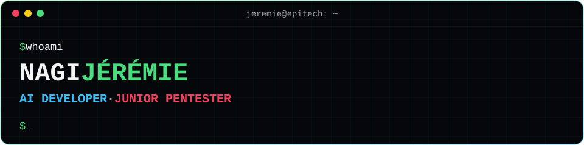

  

  
  
  

  MSc in information systems and cybersecurity at Epitech Marseille · <b>Looking for a work-study position</b> · Internship possible 
  French · English · Spanish · Arabic

## Skills

| Domain | What I work with |
| --- | --- |
| **Applied AI** | LLM applications · RAG · speech pipelines · LangChain · FAISS · Hugging Face · PyTorch · spaCy |
| **AI security** | Prompt injection · LLM guardrails · Promptfoo · garak · PyRIT |
| **Pentest** | Web · Active Directory · Linux and Windows privilege escalation · Burp Suite · Nmap · ffuf · SQLMap · Metasploit · BloodHound · Impacket · NetExec · Hashcat |
| **Cyber defense** | Log and traffic analysis · malware analysis in a lab · hardening · Splunk · Wireshark · Snort · REMnux · FlareVM |
| **Data** | Pandas · NumPy · GeoPandas · scikit-learn · Parquet |

  

## Certificates and awards

  
  
  
  
  

  
  

